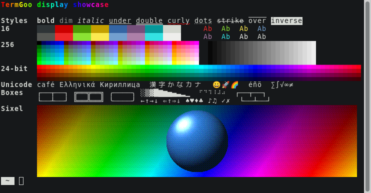

# TermGoo

A terminal emulator for Linux desktops, on X11 and Wayland, built with GTK4 and
written in Rust. Inside the desktop's usual window frame is a blank terminal
screen with an optional scrollbar. Everything else is on the right-click menu.

Created by AI Sloperator with Claude Code.

No license is given.

## Building

You need the GTK 4.10 or newer development files (Debian and Ubuntu:
`libgtk-4-dev`) and, through [rustup](https://rustup.rs), a stable Rust of 1.92 or
newer, which the `gtk4` crate requires. `rust-toolchain.toml` selects the stable
channel.

    cargo build --release
    cargo test
    target/release/termgoo

To install, copy `target/release/termgoo` onto your `PATH`, and optionally
`termgoo.desktop` to `~/.local/share/applications`.

To see what the display can do, `examples/showcase.rs` fills an 80x24 terminal
with styles, colours, Unicode and a Sixel image, ready for a screenshot:

    cargo build --release --example showcase
    target/release/termgoo -hold -e target/release/examples/showcase

## Command line

    termgoo [options] [-e program [args...]]

| Option | Effect |
| --- | --- |
| `-title TEXT`, `-T TEXT` | Initial window title. Programs can change it, as in xterm. |
| `-e PROGRAM [ARGS...]` | Run this instead of the shell. Must come last; all that follows belongs to the program. A single argument with spaces in it that is not a program goes to `$SHELL -c`, as in xterm. |
| `-tn NAME`, `-term NAME` | Value of `TERM`, such as `vt102`. Only what is announced changes: the emulation is the same. |
| `-theme THEME` | Terminal theme for this process: `light`, `dark` or `follow`. |
| `-sl N`, `-scrollback N` | Lines of scrollback to keep. |
| `-fn FONT`, `-font FONT` | Font, such as `"Monospace 11"`. |
| `-geometry CxR` | Initial size in characters, such as `100x30`. |
| `-sb`, `+sb` | Show or hide the scrollbar. |
| `-hold` | Keep the window open after the program exits. |
| `-help`, `-version` | Show help, or the version. |

Command line options apply to that process only. `--title` works as well as `-title`.

## Using it

The right-click menu has Copy, Paste, Select All, the terminal theme, the
scrollbar toggle, Clear Scrollback, Reset Terminal, the
configuration commands, About and Close Window.

| Input | Effect |
| --- | --- |
| Drag; double or triple click | Select by character, word or line |
| Ctrl+Shift+C, Ctrl+Shift+V | Copy, paste |
| Middle click, Shift+Insert | Paste the X11-style primary selection |
| Shift+PageUp, PageDown, Home, End | Move through the scrollback |
| Mouse wheel, scrollbar | Scroll |
| Shift + mouse | Select text or open the menu when a program is using the mouse |

## Configuration

`~/.config/termgoo/config`, or under `$XDG_CONFIG_HOME`. "Open Configuration File"
on the menu creates it with every setting listed and opens it in `$VISUAL` or
`$EDITOR`, in a new TermGoo window. With neither set, the desktop's default program
for plain text opens it instead; `xdg-mime query default text/plain` shows which
one that is. "Reload Configuration" applies changes to a running window. Choices
made on the menu are saved here too.

    theme = follow           # light, dark, or follow the desktop
    scrollback = 10000
    scrollbar = true
    font = Monospace 11      # unset by default; see below
    term = xterm-256color

    [light]
    foreground = #2e3436
    background = #fafaf7
    cursor = #2e3436
    selection = #b5d5ff
    color0 = #2e3436         # through color15

    [dark]
    # The same keys.

Without a `font` setting or `-fn`, the font comes from the desktop. GNOME's
`monospace-font-name` is used in a GNOME session, or anywhere if it has been set
explicitly. Otherwise, the font is `Monospace` at the size of GTK's `gtk-font-name`,
so that a GTK setup without the rest of GNOME gets the size it configured. This is
read at startup and by "Reload Configuration". A `font = Monospace 11` line written
by an earlier version counts as a choice, so delete it to get the desktop's font.

The two terminal themes are separate from the desktop's GUI theme, which the
scrollbar and menus always follow. The desktop's light or dark preference comes
from the XDG settings portal, with the GTK theme's name as a fallback.

## Emulation

Close to xterm, using the `xterm-256color` terminfo entry by default:

- Sixel graphics, Unicode (UTF-8, double-width, combining characters), and
  16, 256 and 24-bit colour.
- Bold, dim, italic, blink, inverse, hidden, strikethrough, overline and underline
  styles and colours.
- Alternate screen, scroll regions, origin mode, insert mode, tab stops, selective
  erase, DEC line drawing and cursor shapes.
- Mouse reporting (X10, normal, button and any-motion, in the default and SGR
  formats), focus reporting and bracketed paste.
- Device status and attribute reports, DECRQM, DECRQSS, XTVERSION, XTSMGRAPHICS, window
  size reports, the title stack, and OSC 4, 10, 11 and 12 colours.

These are refused on purpose, so that output from a program cannot act on your
behalf:

- Anything that remaps keys: DECUDK, ANSI.SYS key reassignment, modifyOtherKeys and
  progressive keyboard protocols. Cursor and keypad application modes remain, as
  full-screen programs need them.
- OSC 52 clipboard access.
- Moving or resizing the window from the program.

Tektronix graphics, tabs and multiplexing are left out by design.

Changing the window's width rewraps the text on the main screen and in the
scrollback, as long as no image is on the line. Lines with a Sixel image are cut
at the edge instead, as is the alternate screen, where programs redraw themselves.

Not implemented yet: left and right margins (DECSLRM), rectangular area operations, double-width and double-height lines,
132-column switching, on-screen input method preedit text, 8-bit (non-UTF-8) mode,
and drawing unset Sixel pixels in anything but the background.
